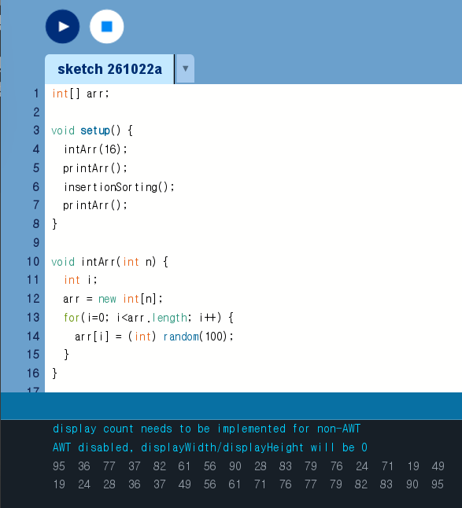
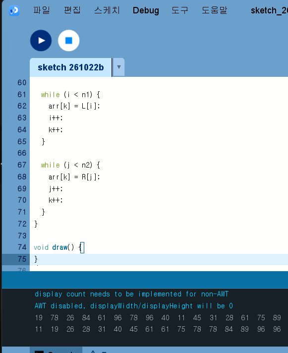
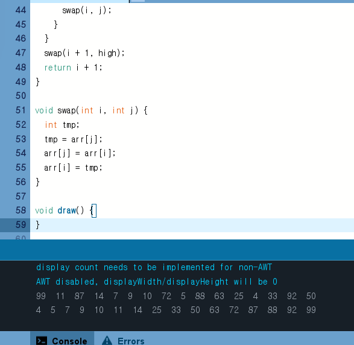
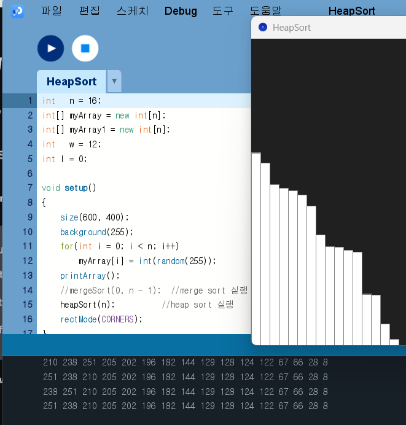

# Algorithm2026

## Homework1

[selectionSorting](selectionSorting.pde)

[bubbleSorting](bubbleSorting.pde)

[Insertion](Insertion.pde)

[Merge](Merge.pde)

[Quick](Quick.pde)

[HeapSort](HeapSort.pde)

## Homework2
[Array](Array.pde)
https://youtu.be/2FDLhdIqWgI

[SortAnimation](SortAnimation.pde)
https://youtu.be/J4LPWF09E74

## Honework3
[BinarySearchTree.pde](BinarySearchTree.pde)
https://youtu.be/7hbS0LOqoiQ
